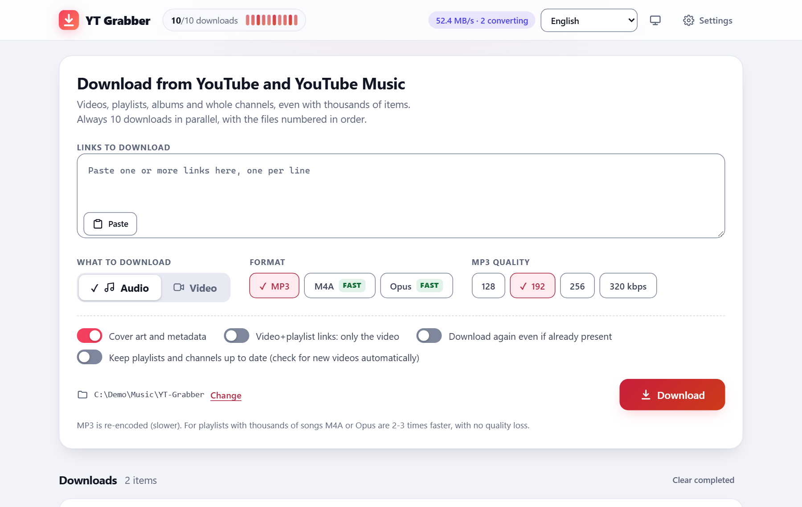
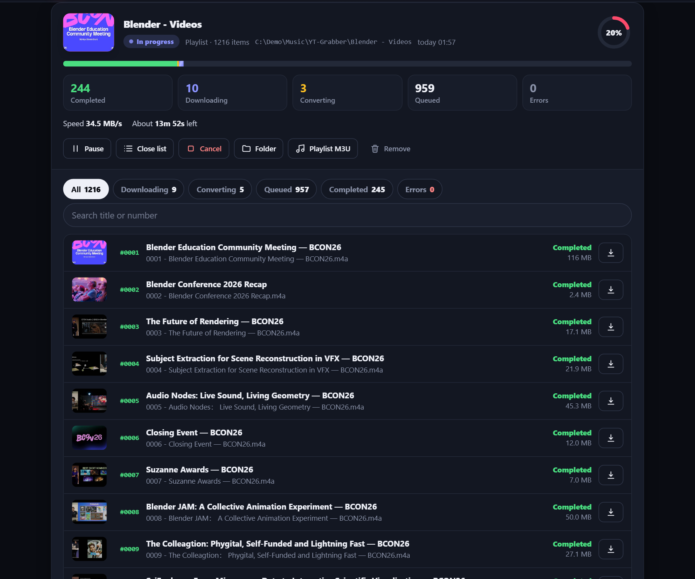
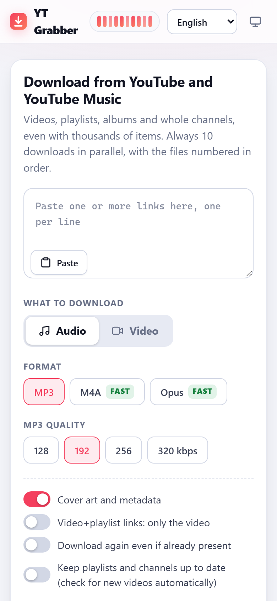

# YT Grabber

[](https://github.com/progliodario/YT-Grabber/releases/latest)
[](https://github.com/progliodario/YT-Grabber/actions/workflows/ci.yml)
[](LICENSE)

Download **videos, playlists (even with thousands of items), albums and whole channels** from YouTube and YouTube Music.
It runs on your own computer or phone and is used from a local web page, in any browser.



## Features

- **Always 10 downloads at the same time**, even with several playlists in the queue.
- Files are **numbered in playlist order** (`001 - Title.mp3`, `002 - ...`).
- Every video that fails is **listed with its number and the exact reason**, with a one-click retry.
- **Stop and resume** at any time: finished files are recognized and skipped.
- **Subscriptions**: follow a channel or playlist and the new videos are downloaded by themselves. Optionally, download
  **only the new ones** and not what is already there.
- **Notifications** when a download has finished and when a new version of YT Grabber is out (both can be switched off).
- **16 languages**: English, Italiano, Español, Français, Deutsch, Português, Nederlands, Polski, Русский, Türkçe,
  العربية, हिन्दी, Bahasa Indonesia, 中文, 日本語, 한국어. The interface follows your device and can be changed from the page.
- Audio (MP3, M4A, Opus) or video (up to 4K), with cover art and tags.
- **Accessible**: fully usable with the keyboard and with screen readers, high contrast and forced-colours modes, zoom up to 400%,
  reduced motion and touch screens. It aims at WCAG 2.2 level AA and is checked automatically at every change
  ([accessibility statement](docs/accessibility.md)).
- Free and open source ([MIT](LICENSE)). Nothing is sent anywhere except to YouTube and GitHub
  (see [SECURITY.md](SECURITY.md)).

| The list of a playlist, dark theme | On a phone |
|---|---|
|  |  |

More screenshots are in the [usage guide](docs/usage.md).

## Install

Ready-made files are on the [releases page](https://github.com/progliodario/YT-Grabber/releases/latest).
Every platform has step-by-step instructions in **[docs/install.md](docs/install.md)**.

| You have | Easiest way |
|---|---|
| **Windows** | `YT-Grabber-Setup-<version>.exe` (a normal installer), or `winget install progliodario.YTGrabber`, or `scoop install yt-grabber` |
| **macOS** (Intel and Apple Silicon) | `brew install --cask progliodario/tap/yt-grabber`, or the `YT-Grabber-macOS.zip` app |
| **Debian, Ubuntu, Mint** | the signed **apt repository** (updates by themselves), or the `.deb` |
| **Fedora, RHEL, openSUSE** | the signed **dnf repository** (updates by themselves), or the `.rpm` |
| **Any Linux** | the **AppImage** (one file) or the **Flatpak** |
| **Android** | the `YT-Grabber-arm64-v8a.apk` app (no computer needed), or Termux |
| **iPhone / iPad** | open the page served by a computer or a Raspberry Pi: there cannot be an iOS app |
| **Anything with Python 3** | run `Start.bat` (Windows) or `./Start.sh` (Linux, macOS, Termux) from this folder |

## Quick start

1. Start YT Grabber (from the Start menu, the applications menu, the app icon, or `Start.bat` / `./Start.sh`).
   The page opens by itself at `http://localhost:8765/`.
2. Paste one or more links, one per line, and press **Download**.
3. The files go to the `Downloads/YT-Grabber` folder of your user (change it in *Settings*).

The first start installs what it needs (yt-dlp, a JavaScript runtime, ffmpeg): you need Internet and about 200 MB, once.

## Documentation

| | |
|---|---|
| [docs/install.md](docs/install.md) | installing, updating and removing, for every platform |
| [docs/usage.md](docs/usage.md) | the interface, numbering, errors, resuming, cookies, subscriptions, command-line options, troubleshooting |
| [docs/accessibility.md](docs/accessibility.md) | keyboard use, screen readers, what has been done and checked for accessibility, known limits |
| [docs/development.md](docs/development.md) | how it works inside, running from source, tests, building, releasing |
| [CONTRIBUTING.md](CONTRIBUTING.md) | reporting problems, fixing a translation, sending a change |
| [SECURITY.md](SECURITY.md) | checking that a download is genuine, antivirus and "unknown publisher" warnings, privacy |
| [CHANGELOG.md](CHANGELOG.md) | what changed in each version |

### Is the file I downloaded genuine?

Every release has `SHA256SUMS` and a GPG signature (`SHA256SUMS.asc`), the files built on GitHub carry a build attestation
(`gh attestation verify <file> --repo progliodario/YT-Grabber`), and the apt and dnf repositories are signed.
[SECURITY.md](SECURITY.md) shows how to check.

## Folders

```
YT-Grabber/
├─ README.md  CHANGELOG.md  SECURITY.md  CONTRIBUTING.md  LICENSE
├─ Start.bat  Start.sh      run from the sources (needs Python 3)
├─ program/                 the program: server.py, ytworker.py, ytcommon.py, setup_tools.py, web/ (the interface)
├─ packaging/               what is needed to build each package: windows/ android/ linux/ macos/ termux/
├─ tools/                   helper scripts for the maintainer (bump_version.py)
├─ tests/                   unit tests
├─ docs/                    guides, the release signing key and the screenshots
├─ .github/                 automatic tests and release builds (GitHub Actions), issue templates
├─ dist/                    (not in git) the packages you build yourself
└─ generated/               (not in git) data created when you run from the sources: tools, settings, logs
```

## Building and contributing

Nothing needs to be built to run the program from the sources. The packages are built by GitHub Actions for every
release (see [docs/development.md](docs/development.md)); each folder in `packaging/` also has a guide to build its
package yourself. Contributions are welcome: see [CONTRIBUTING.md](CONTRIBUTING.md).

## License and third-party components

YT Grabber is released under the [MIT License](LICENSE). It builds on other projects, each with its own license:
[yt-dlp](https://github.com/yt-dlp/yt-dlp) (downloading), [FFmpeg](https://ffmpeg.org/) (conversion, downloaded on first
start from [yt-dlp/FFmpeg-Builds](https://github.com/yt-dlp/FFmpeg-Builds)), [Deno](https://deno.com/) (JavaScript runtime),
[PyInstaller](https://pyinstaller.org/) and [Inno Setup](https://jrsoftware.org/isinfo.php) (the Windows app and its
installer), [youtubedl-android](https://github.com/yausername/youtubedl-android) (Python and FFmpeg for the Android app) and
[python-build-standalone](https://github.com/astral-sh/python-build-standalone) (the Python of the AppImage and the Mac app).
Programs and apps that bundle them are also subject to their licenses.

## Responsible use

Only download content you have the right to save (yours, freely licensed, or for personal use where the law allows it).
Downloading may violate YouTube's Terms of Service. This project is not affiliated with YouTube or Google.
