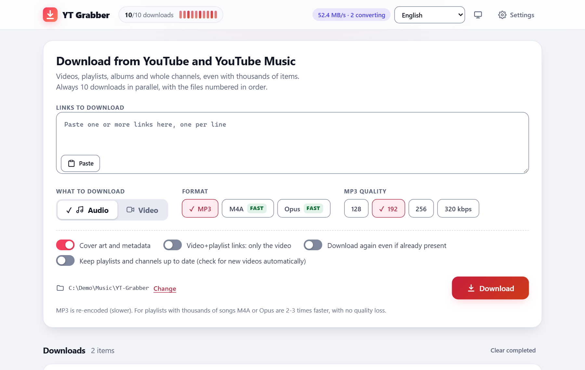
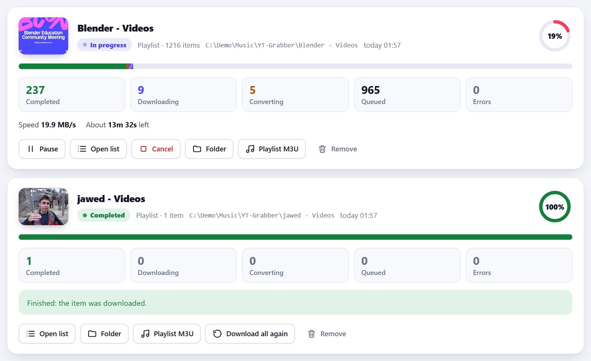
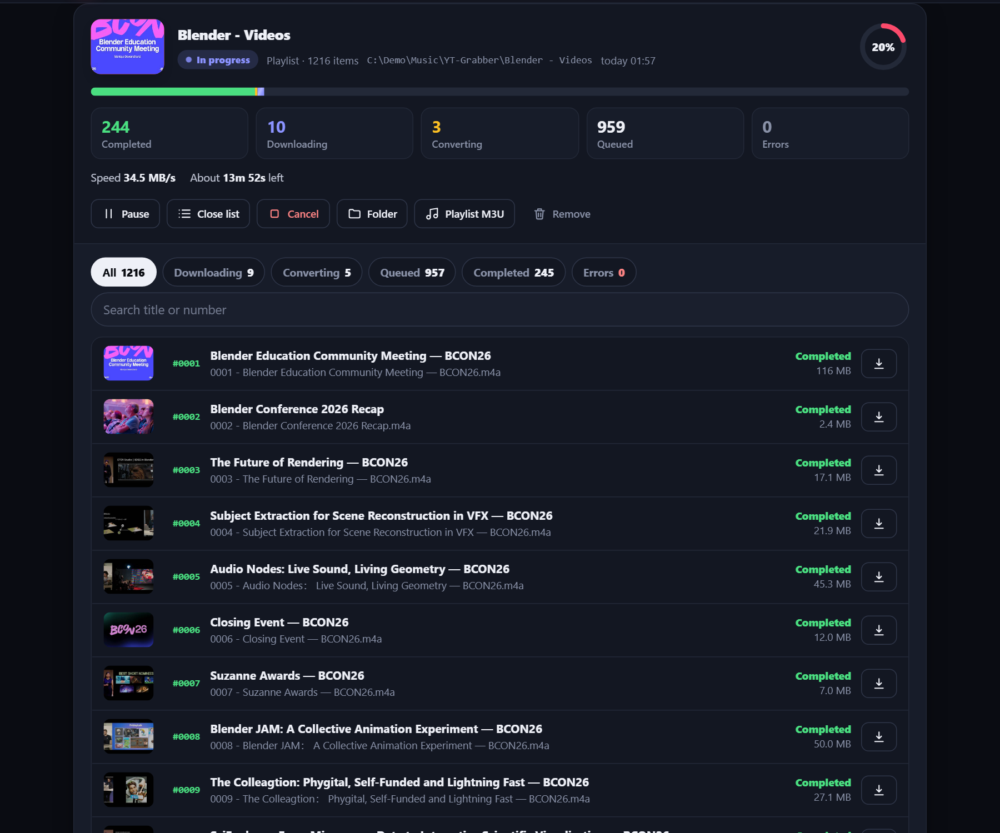
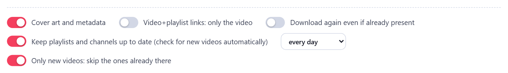
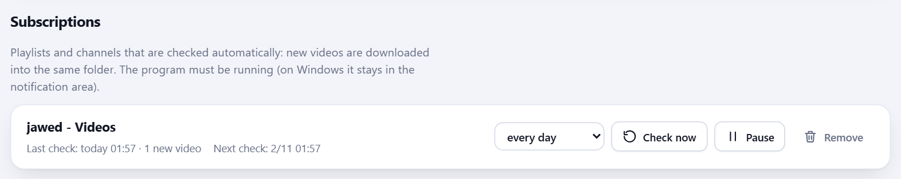
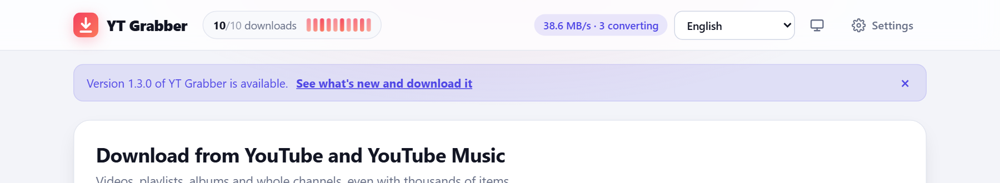
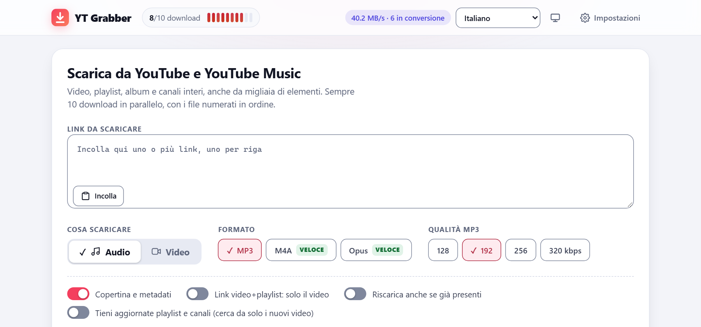
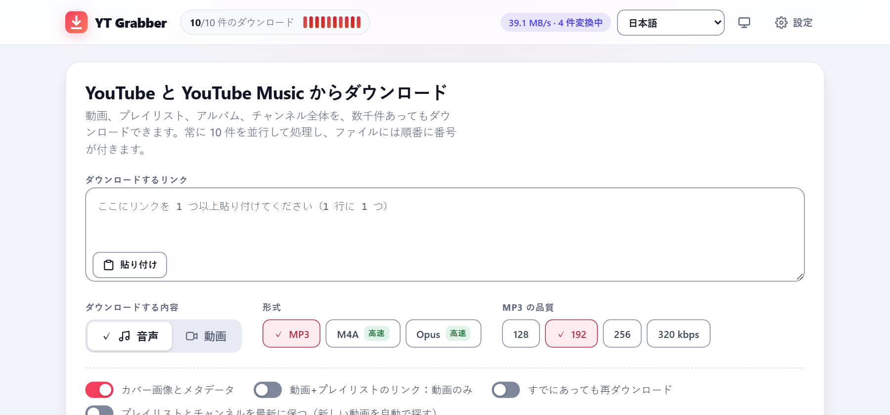
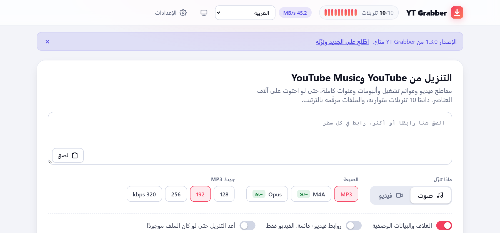
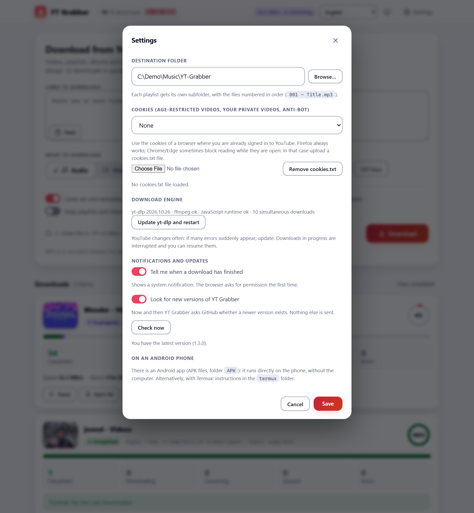

# Using YT Grabber

Installation is described in the [installation guide](install.md). This guide describes how to use the program.

- [Downloading](#downloading) · [Numbered files](#numbered-files-in-order) · [Errors](#errors-which-ones-and-why) ·
  [Resuming](#resuming-after-a-stop) · [Cookies](#cookies)
- [Subscriptions](#subscriptions) · [Notifications and new versions](#notifications-and-new-versions) · [Languages](#languages)
- [Settings](#settings) · [Command-line options](#command-line-options) · [Where things are stored](#where-things-are-stored) ·
  [If something stops working](#if-something-stops-working)

Every function can be used with the keyboard, and the program works with screen readers, high contrast and zoom. The keys and
further details are given in the [accessibility statement](accessibility.md).

## Downloading

1. Paste one or more links in the box, **one per line**. Videos, playlists, albums, entire channels and YouTube Music links are
   all accepted and can be mixed. While the links are pasted, a line below the box shows what was recognised (playlist, video,
   invalid link).
2. Choose **what to download**:
   - **Audio**: **MP3** (re-encoded, therefore the slowest), **M4A** or **Opus** (not re-encoded: two to three times faster, with
     no loss of quality, and the best choice for very large playlists). For MP3, the quality is also selected (128, 192, 256 or
     320 kbps).
   - **Video**: the best available quality up to the chosen height (360p to 4K), saved as MP4.
   - *Cover art and metadata* adds the thumbnail and the tags to the files.
   - *Video+playlist links: only the video*: a link to a video that belongs to a playlist downloads only that video.
   - *Download again even if already present*: ignores the files that are already in the folder.
3. Press **Download**. Several links produce several cards in the list. The same link cannot be added twice while it is in progress.

**Exactly 10 downloads run at the same time** in total, even when several playlists are queued. The list is read in blocks, and the
downloads start immediately, without waiting for the end of the list. When a file has been downloaded and passes to conversion
(ffmpeg), its slot is released at once, so the network already downloads the next song while the processor converts the previous
ones.

Each card shows the cover art, a progress ring, the counters (completed, downloading, converting, queued, errors), the speed and the
estimated time. The buttons are **Pause** / **Resume**, **Open list**, **Cancel**, **Folder** (opens the folder), **Playlist M3U**
(the playlist in order, to be opened with VLC and similar players), **Download all again** and **Remove**. *Clear completed* empties
the list without touching the files.

**Open list** shows every item with its thumbnail, number and state, a search box (by title or number) and filter tabs (all,
downloading, converting, queued, completed, errors). The theme is light, dark or automatic (button at the top right). Within the
list, the arrow keys move from one item to the next.

## Numbered files, in order

Each playlist has its own folder, and the files are named `001 - Title.mp3`, `002 - ...`. The number is the position in the
playlist, so the order is always that of the playlist. The number of digits grows with the playlist (four digits above 999 items,
and so on). The folder also contains `_playlist.m3u8` and, if errors occurred, `_ERRORS.txt`. Single videos are saved in the
`Singles` folder, without a number. If the playlist changes later, the numbers in the file names are updated.

## Errors: which ones, and why

- The card shows the **exact numbers** of the videos that failed (`Numbers: #012 #044 ...`).
- *Open list* → **Errors** tab: for each failure, the number, the title, the **reason** (private video, deleted, blocked in the
  country, sign-in required, YouTube Music Premium only, network, and so on), the technical message and a **Retry** or **Open** (on
  YouTube) button.
- The red panel groups the errors by reason (selecting one filters the list) and offers **Retry all errors**, **Copy list** and
  **Download list (.txt)**.
- Private and deleted videos are reported immediately, while the playlist is still being read.
- Temporary errors (network, rate limit) are retried automatically. If YouTube limits the requests, an **automatic pause** starts
  and downloading resumes by itself.

## Resuming after a stop

If the program is closed or the computer shuts down, the downloads stop but their state is saved. After YT Grabber is opened again,
pressing **Resume** on the download continues it. Files that are already present are recognised and skipped without connecting to
the Internet.

## Cookies

Cookies are needed only for age-restricted videos, for the user's own private videos, or when YouTube asks to "confirm you're not a
bot". In *Settings → Cookies*, select a browser in which the user is already signed in to YouTube (Firefox is the most reliable;
Chrome and Edge sometimes prevent their cookies from being read while they are open) or upload a `cookies.txt` file exported from
the browser. Normal public videos do not need cookies.

## Subscriptions

Select **Keep playlists and channels up to date** under the link box, choose how often to check (from every hour to once a week)
and press **Download**. The link is downloaded immediately and then checked at that interval. Only the videos that are not already in
the folder are downloaded, so a check never repeats work.

To receive only what is published **from now on**, also select **Only new videos: skip the ones already there**. YT Grabber then
records everything that is in the playlist, album or channel at that moment, downloads none of it, and from the next check onwards
downloads only the videos that were not on that list. The files keep the number of their position in the playlist, and the skipped
videos are listed as *Skipped*. To change the mode of an existing subscription, subscribe to the same link again with the option
selected or cleared: what exists at that moment becomes the starting point.

The **Subscriptions** section lists everything that is followed: when it was last checked, how many videos were found, the *only new
videos* tag, and buttons to change the interval, check immediately, pause or remove.

The program must be running for the checks to take place (on Windows it remains in the notification area; on Linux the packages
include a systemd service, see the [installation guide](install.md#subscriptions-in-the-background)). A check that finds nothing new
leaves no card in the list.

## Notifications and new versions

- When a download finishes, a **system notification** is shown: a bubble from the tray icon in the Windows application, and a browser
  notification elsewhere (the browser asks for permission the first time; if it is blocked, it must be allowed in the site
  settings). Subscription checks that find nothing new remain silent. In the Android application it is a normal notification of the
  application (Android asks for permission the first time; the progress notification is unchanged).
- When a newer version of YT Grabber exists, a **notice** appears at the top of the page. To detect it, the program asks GitHub twice
  a day for the latest release, sending only the program name and version.
- In the **Windows application**, the notice has an **Update now** button. It asks for confirmation, downloads the installer from
  the project's releases, checks its SHA-256 fingerprint against the one published by GitHub, closes the application, installs the
  new version and opens it again. Nothing is installed if the fingerprint does not match. Installations made with Scoop, winget or
  Chocolatey are updated with their own tool, so the button is not shown for them.

Both functions can be disabled in *Settings → Notifications and updates*, where *Check now* also looks for a new version
immediately.

## Languages

16 languages are available: English, Italiano, Español, Français, Deutsch, Português, Nederlands, Polski, Русский, Türkçe, العربية,
हिन्दी, Bahasa Indonesia, 中文, 日本語, 한국어. The page uses the language of the browser, which can be changed with the selector at the
top; the choice is remembered. The Windows application (menu, start-up window, installer) and the Android application follow the
language of the device. Arabic is shown right to left. The translations were written with an AI model and may need corrections; see
[CONTRIBUTING.md](../CONTRIBUTING.md#translations).

| Italiano | 日本語 | العربية |
|---|---|---|
|  |  |  |

## Settings

- **Destination folder**: where the folders of the playlists are created.
- **Cookies**: see above.
- **Download engine**: the versions of yt-dlp, ffmpeg and the JavaScript runtime, and *Update yt-dlp and restart*.
- **Text size**: 100%, 125%, 150% or 200%, in addition to the zoom of the browser. The choice is remembered on the device.
- **Notifications and updates**: see above.

## Command-line options

These options are passed to `Start.bat`, `./Start.sh`, `yt-grabber`, the AppImage or `YT-Grabber.exe`.

| Option | Meaning |
|---|---|
| `--port 9000` | the port of the page (default 8765; if it is busy, the next free port is used) |
| `--dir D:\Music` | the destination folder |
| `--host 0.0.0.0` | accept other devices on the network (a phone or a tablet), which open `http://COMPUTER-IP:8765/`; the files are still saved on the computer. To be used only on a trusted network |
| `--no-browser` | do not open the page |
| `--idle-exit 10` | quit after this many minutes without use (used by the AppImage and the Flatpak; never while something is downloading or a subscription is active) |
| `--background` | Windows application only: start in the notification area without opening the window |
| `--diag` | Windows application only: print where yt-dlp and the data are loaded from (to be run from a terminal) |

## Where things are stored

| | Settings, list, cookies, tools, logs | Downloads |
|---|---|---|
| Windows (installed) | `%LOCALAPPDATA%\YT-Grabber` | `Downloads\YT-Grabber` |
| Linux packages, AppImage | `~/.local/share/yt-grabber` | `~/Downloads/YT-Grabber` |
| Flatpak | `~/.var/app/io.github.progliodario.YTGrabber` | `~/Downloads/YT-Grabber` |
| macOS | `~/Library/Application Support/YT-Grabber` | `~/Downloads/YT-Grabber` |
| Android application | private to the application | `Download/YT-Grabber` |
| From the sources, Termux | `generated/` next to `Start.bat` / `Start.sh` | `Downloads/YT-Grabber` |

The logs of the download processes are in the `data/logs` folder of the first column.

## If something stops working

- **Many errors at once, or nothing downloads:** YouTube changes frequently. *Settings → Update yt-dlp and restart* resolves the
  problem in most cases.
- **The same error on every video:** update yt-dlp first, then check the cookies.
- **"ffmpeg not found" warning:** conversions require ffmpeg. The Internet connection should be checked and the program restarted,
  because ffmpeg is downloaded at start. On Linux it can also be installed with the package manager.
- **The page does not open:** read the address printed in the terminal (the port may differ if 8765 was busy). On Windows, check that
  YT Grabber is running in the notification area.
- **A phone cannot reach the page:** start the program with `--host 0.0.0.0`, use the address of the computer, and allow the program
  through the firewall on private networks.
- **Slow MP3:** MP3 is re-encoded, whereas M4A and Opus are not and are much faster for large playlists.

If the problem persists, [open an issue](https://github.com/progliodario/YT-Grabber/issues/new/choose) and attach the log.
